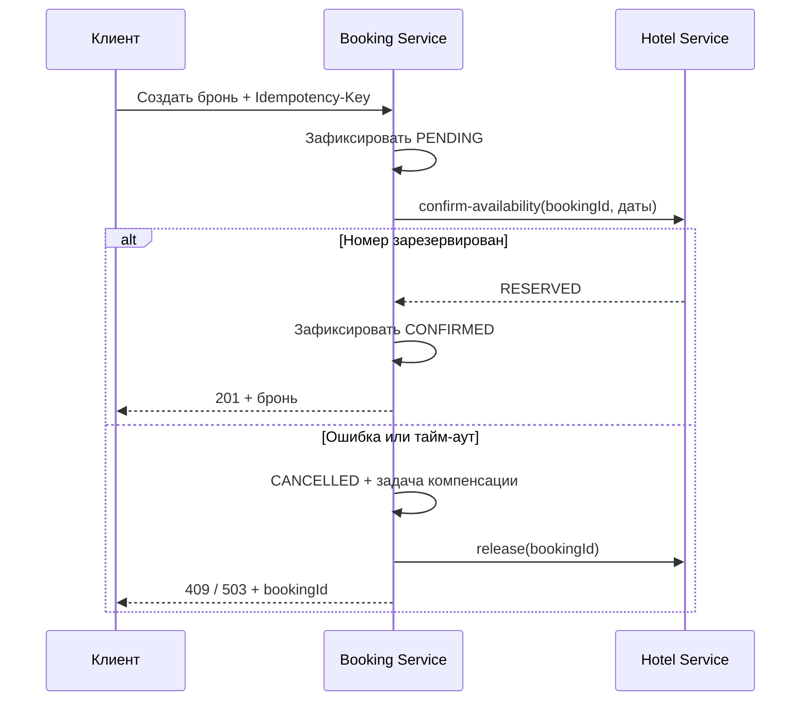

# Hotel Booking API

REST API бронирования отелей на Java 21 и Spring Boot 3.5.7. Система разделена на четыре приложения; HTTP-запросы проходят через Spring Cloud Gateway, адреса сервисов определяются через Eureka.

## Запуск

Нужны JDK 21, `curl`, OpenSSL и Python 3 для демонстрационной проверки. Maven скачивает Wrapper при первом запуске.

```sh
./mvnw verify
./scripts/run-local.sh --skip-build
python3 scripts/smoke-test.py
./scripts/stop-local.sh
```

Если стандартные порты заняты, их можно заменить:

```sh
DISCOVERY_PORT=18761 HOTEL_PORT=18081 BOOKING_PORT=18082 GATEWAY_PORT=18080 ./scripts/run-local.sh --skip-build
API_URL=http://localhost:18080 python3 scripts/smoke-test.py
```

Без `--skip-build` скрипт запуска сначала собирает JAR. Логи находятся в `.local/logs`, PID — в `.local/pids`. Скрипты не требуют Docker. Windows: собрать через `mvnw.cmd`, создать RSA-ключи OpenSSL и запускать JAR вручную из корня репозитория.

| Приложение | Порт | Назначение |
|---|---:|---|
| API Gateway | 8080 | Внешний API |
| Hotel Service | 8081 | Отели, номера, резервирование и статистика |
| Booking Service | 8082 | Пользователи, JWT и бронирования |
| Eureka Server | 8761 | Реестр сервисов |

Swagger UI: [Hotel](http://localhost:8081/swagger-ui.html), [Booking](http://localhost:8082/swagger-ui.html). Спецификации: `/v3/api-docs` на соответствующем сервисе. Состояние каждого приложения: `/actuator/health`.

При запуске создаются два отеля, четыре доступных номера и один номер вне эксплуатации. Демонстрационные пользователи:

| Логин | Пароль | Роль |
|---|---|---|
| `admin` | `Admin12345!` | ADMIN |
| `alice` | `Alice12345!` | USER |

`DEMO_ENABLED=false` отключает предзаполнение. Эти учётные записи предназначены для локальной демонстрации.

## Пример работы

Получить токен через `POST /api/auth/login`:

```json
{"username":"alice","password":"Alice12345!"}
```

В ответе поле `accessToken`. Передавать его в заголовке `Authorization: Bearer <accessToken>`. Токен действует один час.

1. `GET /api/hotels` — выбрать отель.
2. `GET /api/rooms/recommend?startDate=2027-01-10&endDate=2027-01-13` — получить свободные номера по возрастанию `timesBooked`, затем `id`.
3. `POST /api/bookings` с заголовком `Idempotency-Key: january-trip-1`:

```json
{"roomId":1,"autoSelect":false,"startDate":"2027-01-10","endDate":"2027-01-13"}
```

Для автоподбора передать `autoSelect:true`; `roomId` игнорируется, необязательный `hotelId` ограничивает выбор отелем. Даты в примере нужно заменить, если они уже прошли.

4. `GET /api/bookings` — своя история с пагинацией.
5. `DELETE /api/bookings/{id}` — отменить бронь и освободить номер.

Период проживания — `[startDate, endDate)`: выезд и следующий заезд в один день не конфликтуют. Заезд не может быть в прошлом, выезд должен быть позже заезда; максимальный период — один год. Идентификатор пользователя берётся из токена.

## API

Все пути ниже доступны через Gateway. Списки используют `page` (от нуля) и `size` (1–100).

| Метод и путь | Доступ | Описание |
|---|---|---|
| `POST /api/auth/register` | Публичный | Регистрация USER и выдача JWT |
| `POST /api/auth/login` | Публичный | Вход |
| `GET /api/users`, `GET /api/users/{id}` | ADMIN | Пользователи |
| `POST /api/users` | ADMIN | Создание пользователя с ролью |
| `PATCH /api/users/{id}` | ADMIN | Изменение данных, роли или активности |
| `DELETE /api/users/{id}` | ADMIN | Отключение пользователя с сохранением истории |
| `POST /api/bookings` | USER, ADMIN | Создание с `Idempotency-Key` |
| `GET /api/bookings` | USER, ADMIN | Только свои брони |
| `GET /api/bookings/{id}` | Владелец | Получение брони |
| `DELETE /api/bookings/{id}` | Владелец | Идемпотентная отмена |
| `GET /api/hotels?q=...` | USER, ADMIN | Поиск по названию/адресу |
| `GET /api/hotels/{id}` | USER, ADMIN | Отель |
| `POST /api/hotels`, `PATCH /api/hotels/{id}`, `DELETE /api/hotels/{id}` | ADMIN | Управление отелями |
| `GET /api/rooms?startDate=...&endDate=...&hotelId=...` | USER, ADMIN | Свободные номера, порядок по id |
| `GET /api/rooms/recommend` | USER, ADMIN | Те же параметры, сортировка по загруженности |
| `GET /api/rooms/{id}` | USER, ADMIN | Данные номера |
| `GET /api/rooms/all` | ADMIN | Все действующие номера, включая недоступные |
| `POST /api/rooms`, `PATCH /api/rooms/{id}`, `DELETE /api/rooms/{id}` | ADMIN | Управление номерами |
| `GET /api/hotels/statistics?startDate=...&endDate=...` | ADMIN | Число резервирований, занятые ночи и процент загрузки |

Для создания номера нужны `hotelId`, `number`, `available`; для изменения — `number` и `available`. Для изменения отеля нужны `name` и `address`. Номер с действующими или будущими резервированиями нельзя удалить или вывести из эксплуатации. Отели и номера удаляются логически, чтобы сохранять связи с историей.

Поддерживаются пути из примеров задания: `/user/register`, `/user/auth`, `/user`, `/user/{id}`, `/booking`, `/booking/{id}`, `/bookings`. `PATCH /user` принимает `id` в теле, `DELETE /user?id=...` — в строке запроса.

Внутренние `POST /api/rooms/{id}/confirm-availability` и `POST /api/rooms/{id}/release` требуют служебный JWT и закрыты в Gateway даже для ADMIN. Входной запрос резервирования: `bookingId`, `startDate`, `endDate`. Освобождение: `bookingId`, `reason` (`COMPENSATION` или `USER_CANCELLATION`).

## Согласованность и повторы



HTTP-вызовы выполняются между локальными транзакциями. Hotel Service блокирует строку номера и в той же транзакции проверяет календарь и сохраняет резерв. Параллельная попытка занять пересекающийся период получает `409`.

Ключ идемпотентности уникален в пределах пользователя. Повтор с теми же параметрами возвращает ту же бронь: `200` для подтверждённой, `202` для ещё обрабатываемой. Другие параметры с тем же ключом дают `409 IDEMPOTENCY_CONFLICT`. Повтор отменённого запроса возвращает сохранённую причину отказа. После отмены новую попытку создают с новым ключом.

Сетевые ошибки, HTTP 5xx и 429 повторяются до трёх попыток с интервалами 100 и 200 мс. Тайм-аут соединения — 1 с, запроса — 2 с. Бизнес-ошибки 4xx не повторяются. Отдельный Circuit Breaker для компенсаций позволяет освобождать резервы, когда цепь создания бронирований разомкнута.

Неудачная компенсация остаётся в `bookings`; обработчик проверяет очередь каждые 5 с и увеличивает интервал повторов до 60 с. `PENDING`, не изменявшийся 120 с, отменяется. В ответах есть `compensationPending`: `true` означает, что освобождение ещё ожидает повторной обработки. Запись об отмене в Hotel Service не позволяет запоздалому подтверждению восстановить резерв.

`timesBooked` увеличивается один раз при первом резервировании. Техническая компенсация уменьшает его один раз; пользовательская отмена сохраняет исторический счётчик. Статистика занятых ночей учитывает только неотменённые резервы, обрезает периоды по границам отчёта и делит на число ночей всех действующих номеров, включая временно недоступные.

## Структура и решения

```text
common/             транспортные DTO, JWT-проверки и HTTP-ошибки
api-gateway/        маршруты и реактивная безопасность
booking-service/    пользователи, бронирования, сага и восстановление
hotel-service/      каталог, календарь и статистика
discovery-server/   Eureka
scripts/            запуск, остановка и сквозная проверка
docs/adr/           решения по данным, транзакциям и безопасности
```

В бизнес-сервисах разделены контроллеры, DTO, сервисы, JPA-сущности и репозитории. Схемы и индексы создаёт Flyway; Hibernate проверяет их соответствие сущностям. Между базами нет внешних ключей или общих JPA-сущностей.

- [Данные и границы сервисов](docs/adr/001-data-and-consistency.md)
- [Идемпотентность и конкурентный доступ](docs/adr/002-idempotency-and-locks.md)
- [JWT и внутренний API](docs/adr/003-security.md)

H2 работает в памяти: перезапуск сервиса удаляет его данные. Каждый бизнес-сервис рассчитан на один экземпляр с собственной базой. Eureka обеспечивает обнаружение адресов; для масштабирования и восстановления после перезапуска нужна общая постоянная БД для экземпляров одного сервиса. Gateway и Eureka не хранят бизнес-данные.

## Конфигурация

| Параметр | По умолчанию |
|---|---|
| `EUREKA_URL` | `http://localhost:8761/eureka/` |
| `JWT_PUBLIC_KEY` | `file:./.local/keys/public.pem` |
| `JWT_PRIVATE_KEY` | `file:./.local/keys/private.pem`, только Booking |
| `DEMO_ENABLED` | `true` |
| `HOTEL_URL` | Пусто: адрес через Eureka; прямой URL нужен для отдельного запуска/тестов |
| `PORT` | Собственный порт каждого приложения |

RSA-пара создаётся локально и исключена из Git. Для ручного запуска выполнить `scripts/generate-keys.sh`, затем `java -jar <модуль>/target/<модуль>-1.0.0.jar` из корня проекта; сначала Eureka, затем бизнес-сервисы и Gateway.

Ошибки возвращаются единообразно: `timestamp`, `status`, `code`, `message`, `path`, `requestId`, `details`. Основные статусы: `400` — входные данные, `401` — токен/учётные данные, `403` — роль, `404` — объект отсутствует или принадлежит другому пользователю, `409` — конфликт, `503` — недоступен Hotel Service. Логи выводятся в JSON с полями событий и корреляции. `X-Request-Id` проходит через Gateway и оба сервиса, `bookingId` связывает шаги саги в логах. Пароли и токены в рабочих логах не записываются.

## Проверка

```sh
./mvnw verify
./mvnw spotless:apply
```

Первая команда запускает JUnit, проверки форматирования и сборку. Вторая применяет форматтер после изменения кода. Тесты поднимают отдельные H2 и локальные HTTP-заглушки на случайных портах; работающая Eureka не нужна. Покрываются CRUD, JWT, роли, календарь, параллельные брони, повторы, отмена, потеря связи, отложенная компенсация и Circuit Breaker.
