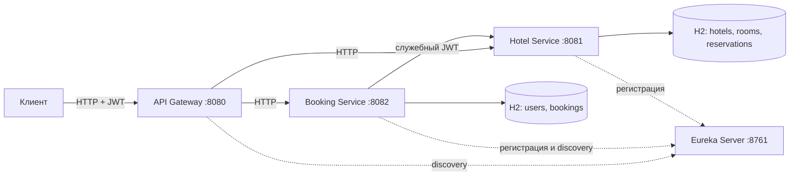

# Hotel Booking API

Работу выполнил Ярцев Владислав.

## Описание проекта

REST API для бронирования гостиничных номеров.

- Пользователь ищет свободные номера, создаёт и отменяет свои брони. Номер можно выбрать вручную или через автоподбор.
- Администратор управляет отелями, номерами и пользователями, просматривает статистику загрузки.

Стек: Java 21, Spring Boot 3.5.7, Spring Cloud, Spring Security, JPA, H2 и Flyway.

## Архитектура

| Приложение | Порт | Назначение |
|---|---:|---|
| [api-gateway](api-gateway/README.md) | 8080 | Принимает внешние запросы |
| [hotel-service](hotel-service/README.md) | 8081 | Хранит отели, номера и календарь занятости |
| [booking-service](booking-service/README.md) | 8082 | Работает с пользователями и бронированиями, выдаёт JWT |
| [discovery-server](discovery-server/README.md) | 8761 | Реестр сервисов Eureka |



Общие DTO и проверка JWT находятся в [common](common/README.md). Booking и Hotel используют отдельные H2 в памяти. При перезапуске сервиса его данные теряются.

## Запуск

Нужны JDK 21, curl и OpenSSL. Для HTTP-проверок нужен Python 3. Maven загружается через Wrapper.

Из корня репозитория нужно выполнить:

```sh
./mvnw verify
./scripts/run-local.sh --skip-build
```

Скрипт создаёт ключи в `.local/keys` и запускает четыре приложения. Логи сохраняются в `.local/logs`.

Для остановки нужно выполнить:

```sh
./scripts/stop-local.sh
```

Другие порты, переменные окружения и ручной запуск описаны в [инструкции по запуску](docs/running.md).

## Пример работы с API

Адрес Gateway: `http://localhost:8080`. По умолчанию доступны тестовые пользователи:

| Логин | Пароль | Роль |
|---|---|---|
| `admin` | `Admin12345!` | ADMIN |
| `alice` | `Alice12345!` | USER |

### Вход

Для получения токена нужно выполнить запрос:

```sh
curl -sS http://localhost:8080/api/auth/login \
  -H 'Content-Type: application/json' \
  -d '{"username":"alice","password":"Alice12345!"}'
```

Вместо `<accessToken>` в следующих запросах нужно указать токен из ответа. Он действует один час.

### Поиск свободных номеров

```sh
curl -sS 'http://localhost:8080/api/rooms/recommend?startDate=2027-01-10&endDate=2027-01-13' \
  -H 'Authorization: Bearer <accessToken>'
```

### Создание брони

```sh
curl -sS http://localhost:8080/api/bookings \
  -H 'Authorization: Bearer <accessToken>' \
  -H 'Content-Type: application/json' \
  -H 'Idempotency-Key: trip-2027-01' \
  -d '{"roomId":1,"autoSelect":false,"startDate":"2027-01-10","endDate":"2027-01-13"}'
```

Для автоподбора нужно указать `"autoSelect":true`. Если даты примера уже прошли, нужно заменить их на актуальные.

## Основные эндпойнты

| Метод и путь | Доступ | Назначение |
|---|---|---|
| `POST /api/auth/register`, `POST /api/auth/login` | Публичный | Регистрация и вход |
| `GET /api/hotels` | USER, ADMIN | Поиск отелей |
| `GET /api/rooms` | USER, ADMIN | Свободные номера на выбранные даты |
| `GET /api/rooms/recommend` | USER, ADMIN | Свободные номера по возрастанию загрузки |
| `POST /api/bookings` | USER, ADMIN | Создание брони |
| `GET /api/bookings`, `GET /api/bookings/{id}` | Владелец | Свои брони |
| `DELETE /api/bookings/{id}` | Владелец | Отмена брони |
| `GET /api/hotels/statistics` | ADMIN | Статистика загрузки |

Полный список методов, административные операции и параметры приведены в [справочнике API](docs/api.md). Swagger доступен у [Hotel Service](http://localhost:8081/swagger-ui.html) и [Booking Service](http://localhost:8082/swagger-ui.html).

## Проверка

JUnit-тесты и проверка форматирования запускаются без работающих сервисов:

```sh
./mvnw verify
```

Для HTTP-проверок нужно запустить все четыре приложения с демоданными пользователей `admin` и `alice`:

```sh
python3 scripts/smoke-test.py
python3 scripts/load-test.py
python3 scripts/integration-test.py
```

Сценарии тестирования и соответствие критериям описаны в [инструкции по проверке](docs/verification.md).

## Документация

- [Справочник API](docs/api.md)
- [Настройка и запуск](docs/running.md)
- [Схема данных](docs/database.md)
- [Проверка проекта](docs/verification.md)
- [ADR: разделение данных и согласованность](docs/adr/001-data-and-consistency.md)
- [ADR: идемпотентность и блокировки](docs/adr/002-idempotency-and-locks.md)
- [ADR: JWT и внутренний API](docs/adr/003-security.md)
- [ADR: HTTP-клиент и обработка сбоев](docs/adr/004-http-resilience.md)
