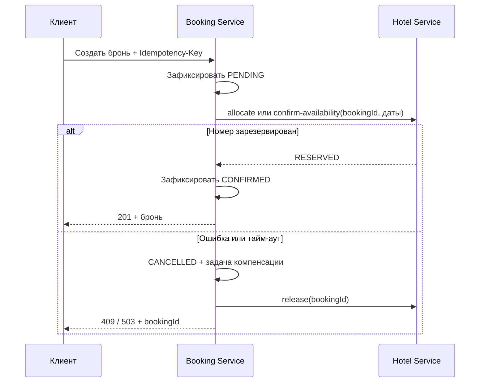

# 1. Независимые базы и согласованность

Статус: принято.

Booking Service владеет пользователями и состояниями бронирования. Hotel Service владеет каталогом и календарём `room_reservations`. Запись календаря связана с бронью через `booking_id`. Прямого чтения чужой базы нет. Дополнительная таблица нужна, чтобы проверка дат и резервирование выполнялись атомарно в одном сервисе.

Создание брони состоит из отдельных транзакций: `PENDING`, HTTP-подтверждение, затем `CONFIRMED` или `CANCELLED`. Глобальная транзакция не используется. Отмена и признак необходимой компенсации фиксируются вместе. Обработчик повторяет освобождение номера и отменяет зависшие `PENDING`. Никакая транзакция не удерживает соединение БД на время HTTP-вызова.

Hotel считает подтверждение доступности фактическим резервом периода. Его состояние `RESERVED` сохраняется до отмены. Завершившиеся периоды не мешают будущим датам. Автоматическое истечение резерва не используется: оно могло бы освободить уже подтверждённую бронь.

H2 in-memory соответствует учебному заданию. Сохранённые задачи переживают ошибки HTTP и обработки запросов, но не уничтожение базы при перезапуске приложения. Для постоянного окружения потребуются дисковая БД и координация обработчиков при нескольких экземплярах.

## Последовательность запросов

